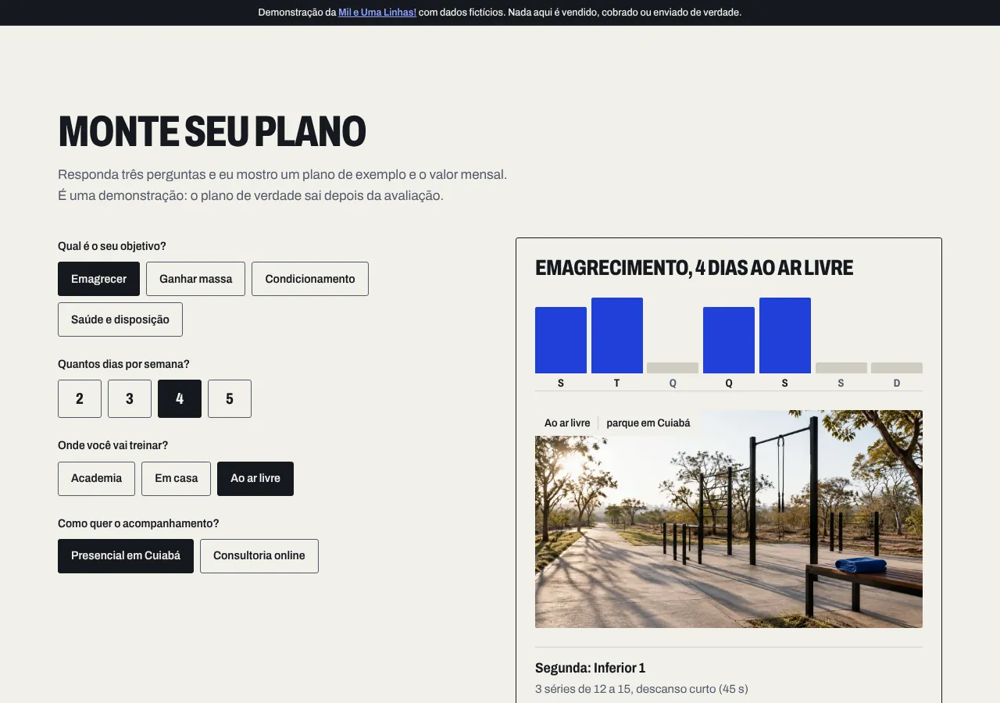
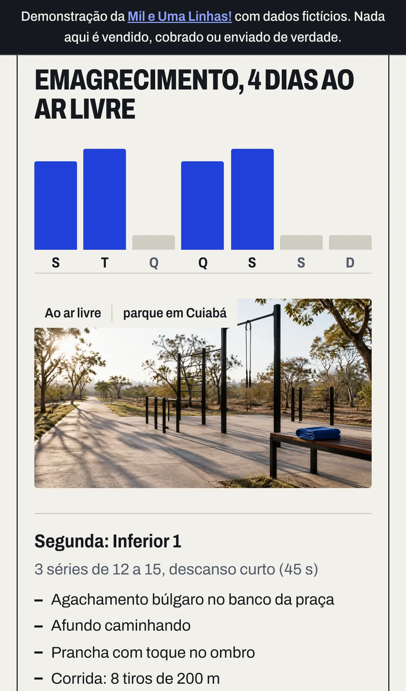
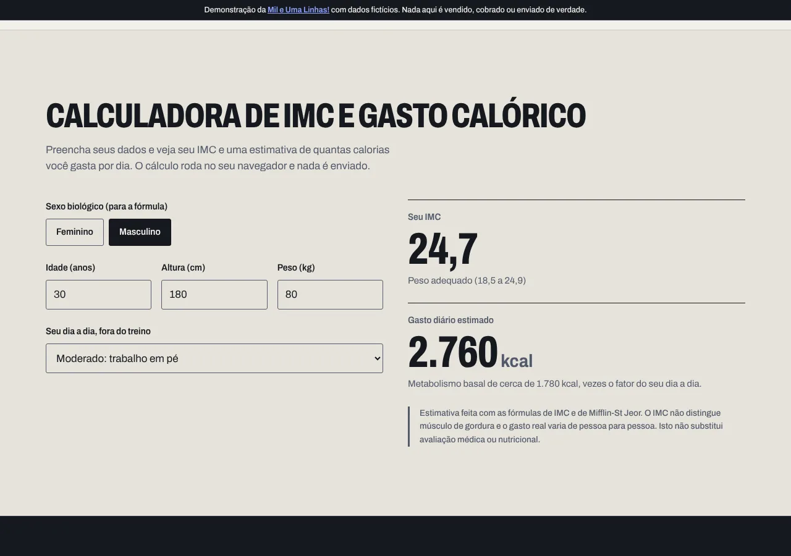
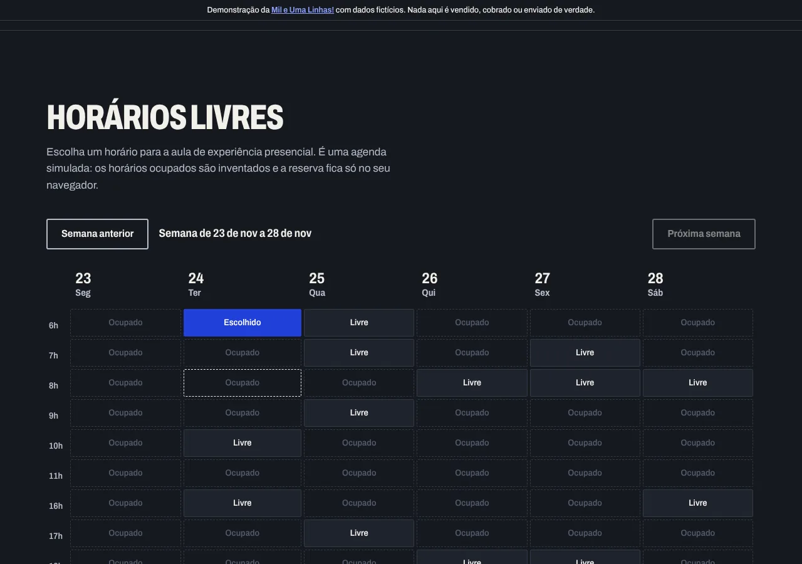
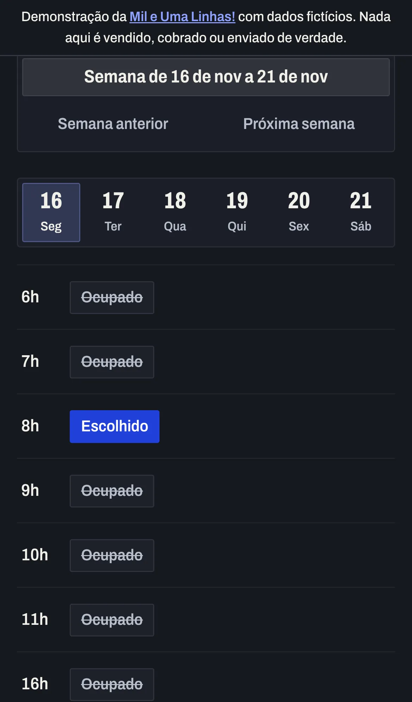

# Cadência Treino

Este é um site de demonstração que eu, Rodrigo Jr, da [Mil e Uma Linhas!](https://mileumalinhas.com.br), fiz para mostrar a personal trainers como poderia ser o site deles. Ele está publicado em https://toshiro01001.github.io/personal/.


## O que é, em uma frase

É o site de um personal trainer inventado, o Tiago Maciel, da "Cadência Treino": você escolhe seu objetivo e vê um plano de treino de exemplo com o preço, calcula seu IMC e seu gasto calórico e escolhe um horário para uma aula de experiência. Tudo funciona na hora, dentro da página.

## Aviso: tudo aqui é fictício

A empresa, o profissional, o endereço, o telefone, os preços, os horários ocupados e os depoimentos foram inventados por mim para a demonstração. Nada é vendido, cobrado, agendado ou enviado de verdade. Uma faixa fixa no topo do site diz isso o tempo todo.

## Como usar, passo a passo

1. Abra https://toshiro01001.github.io/personal/ no celular ou no computador.
2. Em **Monte seu plano**, toque no objetivo, no número de dias, no local e no formato. O plano de exemplo e o valor mensal mudam na hora, à direita (ou logo abaixo, no celular).
3. Em **Calculadora**, digite idade, altura e peso e escolha seu nível de atividade. O IMC e o gasto calórico aparecem enquanto você digita. Se digitar um número fora do razoável, o site avisa.
4. Em **Horários livres**, escolha a semana (botões "Semana anterior" e "Próxima semana"), toque em um horário marcado como "Livre", escreva seu primeiro nome se quiser e toque em **Confirmar aula de experiência**. A confirmação aparece na tela e fica guardada só no seu navegador. **Cancelar reserva** apaga tudo.
5. No fim da página, **Como isto funciona** explica o site para quem não é da área e tem um bloco "Detalhes técnicos" para quem programa.

## Capturas

| Computador | Celular |
| --- | --- |
|  |  |
|  |  |
|  |  |

## Identidade visual, em resumo

O estudo completo está em [`docs/identidade.md`](docs/identidade.md).

- **Nome e ideia**: Cadência Treino. A marca vende constância, não intensidade: "Treino que cabe na sua semana e dura o ano inteiro".
- **Paleta**: Giz `#F2F0EA` (fundo), Ferro `#15181F` (texto e faixas escuras), Aço `#525A6B` (texto secundário), Linha `#CFCCC2` (bordas) e um único destaque, Cobalto `#2140D9`, que aparece em um lugar por tela. Fugi de propósito do preto com laranja e do neon de academia; o resultado lembra uma prancheta de treino.
- **Fonte**: só uma, a Archivo variável (licença OFL), servida do próprio site em `fonts/`. Nos títulos ela fica condensada e pesada, como número de camisa; no texto fica normal. Nenhuma fonte vem de fora.
- **Imagem forte**: um gráfico em SVG com as sete barras da semana, que sobe em sequência quando a página abre. Sem fotos de banco de imagem e sem fotos de pessoas. Ele volta em miniatura no resultado do plano, respondendo à escolha de dias.
- **Movimento**: só a abertura e as respostas a cliques. Com "reduzir movimento" ativado no aparelho, nada se move.

## Como funciona por dentro

O site é um arquivo HTML, um CSS e um JavaScript, lidos direto pelo navegador. Não existe servidor meu, banco de dados nem conta.

- **Montador de plano**: dentro do JavaScript há uma tabela de divisões de treino por número de dias (2 a 5), uma lista de exercícios para cada grupo muscular em três versões (academia, casa, ar livre) e uma tabela de preços por formato. Quando você muda uma opção, o código junta essas peças e redesenha o resultado.
- **Calculadora**: IMC é peso dividido pela altura ao quadrado. O gasto diário usa a fórmula de Mifflin-St Jeor para o metabolismo basal, multiplicada pelo fator de atividade que você escolheu. O resultado é arredondado de 10 em 10 kcal e vem com aviso de que é estimativa.
- **Agenda**: a grade da semana é montada a partir da data de hoje. Os horários "ocupados" vêm de uma função que transforma data e hora em um número sempre igual, então a agenda parece real e não muda a cada recarga. A reserva fica no `localStorage` do seu navegador, com aviso na tela e botão para apagar.

## Detalhes técnicos

- HTML, CSS e JavaScript puros. Sem framework, sem CDN, sem analytics, sem fonte externa.
- Content Security Policy por meta: `default-src 'self'; script-src 'self'; style-src 'self'; img-src 'self' data:; font-src 'self'; connect-src 'none'; object-src 'none'; base-uri 'none'; form-action 'none'`. Nenhum script inline e nenhum atributo `style`.
- Acessibilidade: `lang="pt-BR"`, contraste AA ou melhor em todos os pares de cor, foco visível, formulários com `label`, `fieldset` e `legend`, resultados em regiões `aria-live`, agenda em tabela com cabeçalhos e botões reais, link "pular para o conteúdo".
- Celular primeiro: grade de uma coluna até 900px, calha de 16px abaixo de 600px, agenda com seletor de dia abaixo de 700px, alvos de toque de pelo menos 44px.
- Arquivos: `index.html`, `404.html` (caminhos absolutos em `/personal/`), `robots.txt`, `sitemap.xml`, `favicon.svg`, `css/estilo.css`, `js/app.js`, `fonts/`, `docs/` (identidade, vistoria e capturas), `tests/site.cjs`.

## Como rodar no seu computador

```
cd personal
python3 -m http.server 8306
```

Depois abra http://localhost:8306/ no navegador. Qualquer servidor de arquivos estáticos serve.

## Testes

```
node tests/site.cjs
```

O script usa o Playwright, sobe o servidor sozinho se precisar e testa em três tamanhos: computador 1280x900, iPhone 13 e 320px de largura. Em cada um verifica: nenhum erro de console, nenhum pedido de rede para fora, nenhuma rolagem horizontal, nenhum texto cortado, fonte local carregada, e as três funções (preço e exercícios do plano, valores da calculadora e mensagem de erro, reserva e cancelamento na agenda com `localStorage`). Com `CAPTURAS=1 SHOTS_DIR=/pasta` também salva capturas PNG.

## Segurança

A vistoria está em [`docs/vistoria.md`](docs/vistoria.md). Em resumo: nada sai do navegador, a CSP bloqueia scripts e conexões externas, o único dado guardado é a reserva simulada no `localStorage` (com aviso e botão para apagar) e não há nenhuma dependência em tempo de execução. O repositório é público e não contém dados reais, senhas ou chaves.

## Quem fez

Rodrigo Jr, [Mil e Uma Linhas!](https://mileumalinhas.com.br), Cuiabá. Se você é personal trainer e quer um site assim com a sua cara, é lá que a gente conversa.
